<!--
  README de perfil de Edwar Alama (github.com/Edwxr320)
  - Este archivo va en el repositorio público llamado exactamente "Edwxr320".
  - El banner y el divisor son SVG propios: súbelos a la carpeta /assets del mismo repositorio.
    Así no dependen de ningún servicio externo.
  - Los comentarios marcados con ✏️ indican qué puedes cambiar después.
-->

<!-- ✏️ BANNER: animación propia en assets/banner.svg (nombre + texto que se escribe solo + red neuronal).
     Para cambiar las frases que se escriben, edita el archivo SVG (busca las etiquetas <text class="mono typed">). -->

  

<!-- ✏️ ESTADO: cambia el texto del badge si ya conseguiste tus prácticas. -->

  
  

## Sobre mí

<!-- ✏️ TEXTO: actualiza el ciclo cuando avances. -->
Soy Ingeniero de Software con IA con habilidades en JavaScript, PHP, Python, MySQL, Git y Scrum. Me caracterizo por la responsabilidad, el aprendizaje continuo y el trabajo en equipo. Desarrollo e-commerce completos y modelos de visión por computadora con TensorFlow y Keras, integrando web y Machine Learning para resolver problemas reales. Mi misión es diseñar arquitecturas web escalables con IA para optimizar procesos y generar valor medible en producción.  
## Tecnologías

<!-- ✏️ ICONOS: vienen de skillicons.dev. Para agregar uno, añade su id al parámetro i= (lista en https://skillicons.dev).
     Las que no tienen icono ahí (SQL Server, Oracle, Keras, Colab) van como badges de shields.io. -->
<table>
  <tr>
    <td><b>Frontend</b></td>
    <td></td>
  </tr>
  <tr>
    <td><b>Backend</b></td>
    <td></td>
  </tr>
  <tr>
    <td><b>Bases de datos</b></td>
    <td>
      
      
      
    </td>
  </tr>
  <tr>
    <td><b>IA y datos</b></td>
    <td>
      
      
      
    </td>
  </tr>
  <tr>
    <td><b>Herramientas</b></td>
    <td></td>
  </tr>
</table>

<b>Qué hay detrás de esos iconos</b>

 

| Área | Detalle |
| --- | --- |
| Web | Manipulación del DOM, AJAX, diseño responsive |
| Arquitectura | Programación orientada a objetos, patrón MVC |
| Bases de datos | Modelado relacional y consultas SQL |
| IA | CNN, transfer learning, fine-tuning con MobileNetV2, visión por computadora |
| Trabajo en equipo | Scrum |
| Otros entornos | NetBeans, Oracle SQL Developer |

## Proyectos

<!-- ✏️ TARJETAS: cada <td> es una tarjeta. Para agregar un proyecto nuevo, copia un <td> completo.
     Si un proyecto pasa a estar terminado o en otro estado, cambia su badge de estado. -->
<table>
  <tr>
    <td width="50%" valign="top">
      <h3>FOOD VIDCODE</h3>
      
      
Empezó como la landing page de una hamburguesería y terminó siendo una demo completa de pedidos: catálogo con buscador y filtros, carrito, checkout con validación, cuentas simuladas, historial por usuario y seguimiento del pedido. Todo corre en el navegador con <code>localStorage</code>; no tiene backend ni pagos reales.

      

        
        
        
        
      

      <!-- ✏️ DEMO: enlace tomado del README del repositorio. Si cambias el dominio en Vercel, actualízalo aquí. -->
      <a href="https://github.com/Edwxr320/web"><b>Código</b></a> · <a href="https://sistema-pedidos-food.vercel.app/"><b>Ver demo</b></a>
    </td>
    <td width="50%" valign="top">
      <h3>Emociones faciales con Deep Learning</h3>
      
      
Entrené una CNN desde cero y la comparé con MobileNetV2 (transfer learning + fine-tuning) para clasificar 7 emociones en casi 50 mil imágenes. En mi ejecución la CNN llegó a 59.75&nbsp;% de accuracy de validación y MobileNetV2 a 50.27&nbsp;%; el README explica el proceso y las limitaciones del modelo.

      

        
        
        
        
      

      <a href="https://github.com/Edwxr320/CNN__MobileNetV2__Emociones_Faciales"><b>Notebook y resultados</b></a>
    </td>
  </tr>
  <tr>
    <td width="50%" valign="top">
      <h3>Capi-Barato</h3>
      
      
Tienda de electrónicos con catálogo filtrable por categoría, vista de detalle con galería de imágenes, carrito con control de cantidades guardado en <code>localStorage</code> y página de inicio de sesión.

      

        
        
        
      

      <a href="https://github.com/Edwxr320/web-capi-barato"><b>Código</b></a>
    </td>
    <td width="50%" valign="top">
      <h3>Personas desaparecidas en Perú</h3>
      
      
Proyecto de investigación sobre patrones territoriales y temporales en los registros de personas desaparecidas entre 2019 y 2025. Por ahora el repositorio tiene el dataset con el que trabajo; el análisis todavía no está publicado.

      

        
        
      

      <a href="https://github.com/Edwxr320/Data_set_Personas_Desaparecidas_2019_2025"><b>Dataset</b></a>
    </td>
  </tr>
</table>

## Ahora mismo

<!-- ✏️ ACTUALMENTE: la sección que más rápido envejece. Revísala cada cierto tiempo. -->
- **Construyendo:** el análisis del proyecto de personas desaparecidas (clustering y análisis espacial con Python).
- **Buscando:** prácticas preprofesionales en desarrollo de software.

<b>Formación e idiomas</b>

 

| | |
| --- | --- |
| **SENATI** | Ingeniería de Software con Inteligencia Artificial · 2024-2 – actualidad |
| **Beca 18 – PRONABEC** | Becario del Programa Nacional |
| **Idiomas** | Español nativo · Inglés básico |

## Actividad

<!-- ✏️ ESTADÍSTICAS: usa la instancia pública de streak-stats.demolab.com.
     Si algún día deja de cargar, borra este bloque: tu gráfico de contribuciones nativo de GitHub
     ya aparece debajo del README, así que no hace falta duplicarlo con otro widget. -->

  

## Contacto

<!-- ✏️ ENLACES: LinkedIn, portafolio y correo tomados del CV y del perfil de GitHub. -->
Si tienes una vacante de prácticas o quieres ver algo de lo que hice, estos son los mejores lugares:

  
  
  
  

